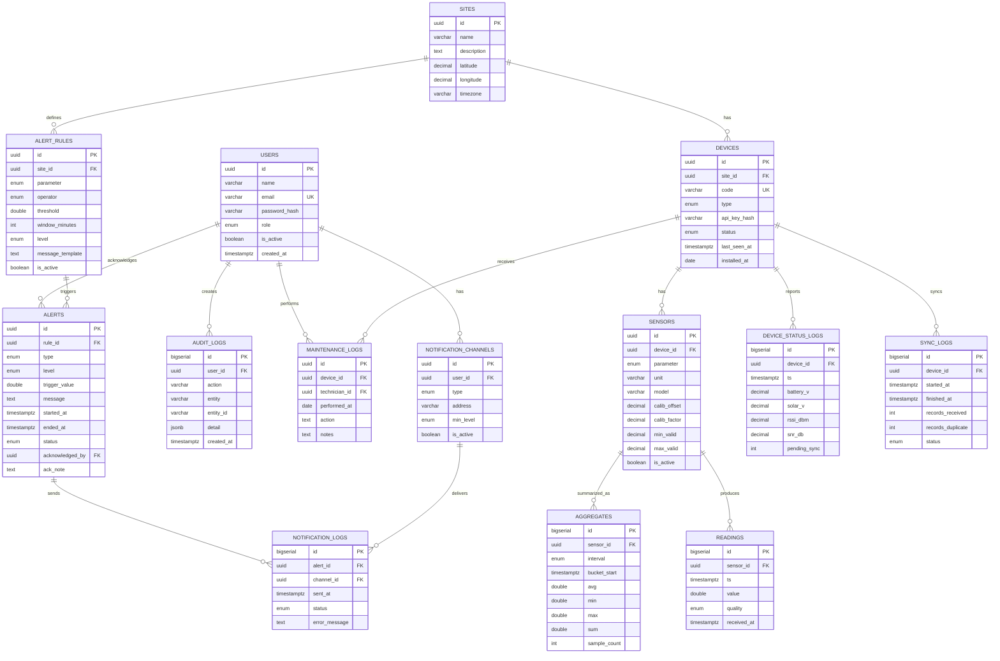

# ERD: Dashboard Cuaca Mikro Pantai Sawarna

**Proyek:** Implementasi Sensor Berbasis IoT dan Edge Computing untuk Mendukung Mitigasi dan Adaptasi Perubahan Iklim di Kawasan Wisata Pantai Sawarna
**Cakupan:** Database dashboard dan pengolahan data
**Versi:** 1.0 (Draf), Oktober 2026

---

## 1. Daftar Relasi

- `sites` 1 — N `devices`
- `devices` 1 — N `sensors`
- `sensors` 1 — N `readings`
- `sensors` 1 — N `aggregates`
- `devices` 1 — N `device_status_logs`
- `devices` 1 — N `sync_logs`
- `devices` 1 — N `maintenance_logs`
- `sites` 1 — N `alert_rules`
- `alert_rules` 1 — N `alerts`
- `alerts` 1 — N `notification_logs`
- `users` 1 — N `alerts` (acknowledged_by)
- `users` 1 — N `maintenance_logs` (technician)
- `users` 1 — N `audit_logs`
- `users` 1 — N `notification_channels`
- `notification_channels` 1 — N `notification_logs`

## 2. Diagram (Mermaid)

Bisa dirender di GitHub, VS Code (ekstensi Markdown Mermaid), atau https://mermaid.live

## 3. Spesifikasi Tabel

### users

| Kolom | Tipe | Keterangan |
|---|---|---|
| id | UUID, PK | |
| name | VARCHAR(100) | |
| email | VARCHAR(150), unik | |
| password_hash | VARCHAR(255) | |
| role | ENUM(super_admin, admin, operator) | Publik tidak punya akun |
| is_active | BOOLEAN | |
| created_at | TIMESTAMPTZ | |

### sites

| Kolom | Tipe | Keterangan |
|---|---|---|
| id | UUID, PK | |
| name | VARCHAR(100) | Contoh: Pantai Sawarna |
| description | TEXT | |
| latitude, longitude | DECIMAL(9,6) | |
| timezone | VARCHAR(40) | Asia/Jakarta |

### devices

| Kolom | Tipe | Keterangan |
|---|---|---|
| id | UUID, PK | |
| site_id | FK → sites | |
| code | VARCHAR(30), unik | EDGE-01, SINK-01 |
| type | ENUM(edge_node, sink_node) | |
| api_key_hash | VARCHAR(255) | Autentikasi ingestion |
| status | ENUM(online, offline, maintenance) | |
| last_seen_at | TIMESTAMPTZ | |
| installed_at | DATE | |

### sensors

| Kolom | Tipe | Keterangan |
|---|---|---|
| id | UUID, PK | |
| device_id | FK → devices | |
| parameter | ENUM(temperature, humidity, pressure, rainfall, wind_speed, wind_dir, uv) | |
| unit | VARCHAR(10) | °C, %, hPa, mm, m/s, ° |
| model | VARCHAR(60) | Tipe sensor |
| calib_offset | DECIMAL | Default 0 |
| calib_factor | DECIMAL | Default 1 |
| min_valid, max_valid | DECIMAL | Rentang fisik wajar untuk validasi |
| is_active | BOOLEAN | |

### readings (data mentah, kandidat hypertable)

| Kolom | Tipe | Keterangan |
|---|---|---|
| id | BIGSERIAL, PK | |
| sensor_id | FK → sensors | |
| ts | TIMESTAMPTZ | Waktu pengukuran |
| value | DOUBLE PRECISION | |
| quality | ENUM(valid, suspect, invalid) | |
| received_at | TIMESTAMPTZ | Waktu diterima server |
| UNIQUE | (sensor_id, ts) | Mencegah duplikasi |

Indeks: `(sensor_id, ts DESC)`.

### aggregates

| Kolom | Tipe | Keterangan |
|---|---|---|
| id | BIGSERIAL, PK | |
| sensor_id | FK → sensors | |
| interval | ENUM(5m, 1h, 1d) | |
| bucket_start | TIMESTAMPTZ | |
| avg, min, max, sum | DOUBLE PRECISION | sum untuk curah hujan |
| sample_count | INT | |
| UNIQUE | (sensor_id, interval, bucket_start) | |

### alert_rules

| Kolom | Tipe | Keterangan |
|---|---|---|
| id | UUID, PK | |
| site_id | FK → sites | |
| parameter | ENUM | Sama dengan sensors.parameter |
| operator | ENUM(gt, gte, lt, lte) | |
| threshold | DOUBLE PRECISION | |
| window_minutes | INT | Jendela evaluasi |
| level | ENUM(waspada, siaga, bahaya) | |
| message_template | TEXT | |
| is_active | BOOLEAN | |

### alerts

| Kolom | Tipe | Keterangan |
|---|---|---|
| id | UUID, PK | |
| rule_id | FK → alert_rules, nullable | Null untuk alert anomali/offline |
| type | ENUM(threshold, anomaly, device_offline) | |
| level | ENUM(waspada, siaga, bahaya) | |
| trigger_value | DOUBLE PRECISION | |
| message | TEXT | |
| started_at | TIMESTAMPTZ | |
| ended_at | TIMESTAMPTZ, nullable | |
| status | ENUM(active, acknowledged, resolved) | |
| acknowledged_by | FK → users, nullable | |
| ack_note | TEXT | |

### notification_channels

| Kolom | Tipe | Keterangan |
|---|---|---|
| id | UUID, PK | |
| user_id | FK → users | |
| type | ENUM(telegram, email, whatsapp) | |
| address | VARCHAR(150) | Chat ID / email / nomor |
| min_level | ENUM(waspada, siaga, bahaya) | Level minimum yang dikirim |
| is_active | BOOLEAN | |

### notification_logs

| Kolom | Tipe | Keterangan |
|---|---|---|
| id | BIGSERIAL, PK | |
| alert_id | FK → alerts | |
| channel_id | FK → notification_channels | |
| sent_at | TIMESTAMPTZ | |
| status | ENUM(sent, failed, retry) | |
| error_message | TEXT | |

### device_status_logs

| Kolom | Tipe | Keterangan |
|---|---|---|
| id | BIGSERIAL, PK | |
| device_id | FK → devices | |
| ts | TIMESTAMPTZ | |
| battery_v, solar_v | DECIMAL | |
| rssi_dbm, snr_db | DECIMAL | Kualitas LoRa |
| pending_sync | INT | Jumlah data belum tersinkron |

### sync_logs

| Kolom | Tipe | Keterangan |
|---|---|---|
| id | BIGSERIAL, PK | |
| device_id | FK → devices | |
| started_at, finished_at | TIMESTAMPTZ | |
| records_received | INT | |
| records_duplicate | INT | |
| status | ENUM(success, partial, failed) | |

### maintenance_logs

| Kolom | Tipe | Keterangan |
|---|---|---|
| id | UUID, PK | |
| device_id | FK → devices | |
| technician_id | FK → users | |
| performed_at | DATE | |
| action | TEXT | Contoh: bersihkan panel surya, ganti sensor |
| notes | TEXT | |

### audit_logs

| Kolom | Tipe | Keterangan |
|---|---|---|
| id | BIGSERIAL, PK | |
| user_id | FK → users | |
| action | VARCHAR(60) | |
| entity, entity_id | VARCHAR | |
| detail | JSONB | Nilai lama dan baru |
| created_at | TIMESTAMPTZ | |

## 4. Catatan Desain

- `readings` dan `aggregates` dipisah agar grafik periode panjang cepat (ambil dari agregasi, bukan data mentah).
- Constraint unik `(sensor_id, ts)` membuat sinkronisasi ulang dari edge aman (idempotent): gunakan upsert / `ON CONFLICT DO NOTHING`.
- Tabel `sensors` dengan kolom `parameter` memudahkan penambahan sensor baru (misalnya UV) tanpa mengubah skema.
- Akses publik tidak butuh tabel khusus: endpoint publik cukup membaca `aggregates`, `alerts`, dan `devices.status`.

## 5. Tabel untuk MVP

`users`, `sites`, `devices`, `sensors`, `readings`, `aggregates`, `alert_rules`, `alerts`, `device_status_logs`, dan `notification_channels`. Sisanya (`notification_logs`, `sync_logs`, `maintenance_logs`, `audit_logs`) ditambahkan setelah MVP.
